# Hi, I'm Tushaar Gupta 👋

  

**Backend & Full-Stack Developer · 4 years of experience**

I build backend systems and full-stack products, from API design and data modeling to responsive web and mobile interfaces. My work spans microservices, authentication and multi-tenant systems, cloud-backed applications, and AI-powered features such as retrieval-augmented generation and semantic search. I also contribute to open-source projects and enjoy collaborating on software that solves practical problems.

[Portfolio](https://imtushaarr.vercel.app/) · [LinkedIn](https://www.linkedin.com/in/imtushaarr/) · [GitHub](https://github.com/imtushaarr)

## What I work on

- Designing and building backend services, REST APIs, and microservice-based systems
- Developing full-stack applications and mobile experiences
- Implementing authentication, authorization, and tenant-aware data access
- Integrating LLMs, retrieval pipelines, embeddings, and semantic search
- Building observable, containerized services and supporting their delivery with CI/CD
- Contributing to open-source software

## Technologies & expertise

**Languages**  
Python · TypeScript · JavaScript · SQL · C++

**Backend**  
FastAPI · Django · NestJS · Node.js · Pydantic · AsyncIO · REST APIs · Microservices · RabbitMQ

**Databases & data stores**  
PostgreSQL · Redis · pgvector · Qdrant · Supabase · NeonDB

**Frontend & mobile**  
React · Next.js · React Native · HTML · CSS

**Cloud, DevOps & observability**  
AWS (CodeCommit) · Azure Blob Storage · GCP · Docker · CI/CD · ELK Stack · Elastic APM · Git

**Authentication & security**  
JWT · OAuth 2.0 · OpenID Connect (OIDC) · SAML · SSO · Multi-tenant data isolation

**AI & data**  
OpenAI API integrations · RAG · LangChain · LangGraph · Embeddings · Semantic search · Pandas

## Selected projects

- [**License & SKU Microservice**](https://github.com/imtushaarr/licence-sku-microservice) — A FastAPI service for product plans, license lifecycles, and entitlement validation, using PostgreSQL, Redis, and Docker.
- [**ProjectVerse**](https://github.com/imtushaarr/ProjectVerse) — A project marketplace with separate [frontend](https://github.com/imtushaarr/ProjectVerse-Frontend) and [backend](https://github.com/imtushaarr/ProjectVerse-Backend) repositories.
- [**KrafChat**](https://github.com/imtushaarr/KrafChat-App) — A real-time chat app built with React, Firebase, and Zustand, including authentication and image sharing.
- [**Autern**](https://github.com/imtushaarr/Autern) — A job-board application built with React, TypeScript, and Firebase.

## GitHub activity

  

  <picture>
    <source media="(prefers-color-scheme: dark)" srcset="https://raw.githubusercontent.com/imtushaarr/imtushaarr/output/github-contribution-grid-snake-dark.svg" />
    
  </picture>

*The statistics card and contribution animation are regenerated daily.*

I’m always happy to connect with people building thoughtful products and useful open-source tools.
